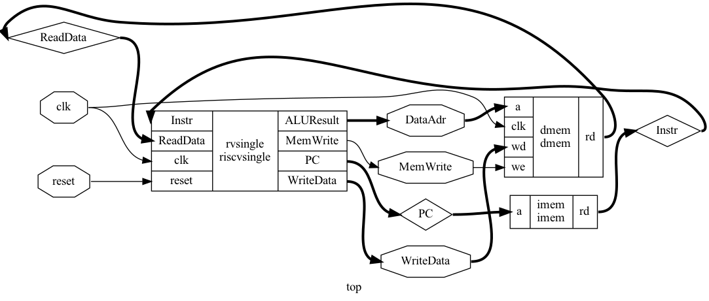

# Single-Cycle RISC-V Processor (RV32I Subset)

A single-cycle 32-bit RISC-V processor implementation in SystemVerilog/Verilog, complete with a self-checking testbench, generic Yosys synthesis netlist, SkyWater 130nm (`sky130_fd_sc_hd`) technology-mapped gate-level netlist, synthesis statistics report, and top-level block schematic.

---

## Table of Contents

- [Project Overview & Objectives](#project-overview--objectives)
- [Repository Structure](#repository-structure)
- [Processor Architecture](#processor-architecture)
  - [Top-Level Hierarchy](#top-level-hierarchy)
  - [Control Unit & Instruction Decoding](#control-unit--instruction-decoding)
  - [Datapath & Submodules](#datapath--submodules)
  - [Supported Instruction Set](#supported-instruction-set)
- [Processor Schematic](#processor-schematic)
- [Simulation & Verification](#simulation--verification)
- [Synthesis & SKY130 Technology Mapping](#synthesis--sky130-technology-mapping)
  - [Synthesis Artifacts](#synthesis-artifacts)
  - [SKY130 Synthesis Statistics](#sky130-synthesis-statistics)
- [Tools Used](#tools-used)
- [Design Notes & Limitations](#design-notes--limitations)
- [Potential Future Improvements](#potential-future-improvements)

---

## Project Overview & Objectives

This project implements a single-cycle RISC-V core (`riscvsingle`) integrated with instruction and data memories (`imem`, `dmem`) under a `top` wrapper module, following the classic single-cycle RV32I microarchitecture.

Key objectives:

- Implement a modular, readable single-cycle RISC-V processor in Verilog/SystemVerilog with separated control and datapath units.
- Verify functional correctness via an automated testbench (`sim/testbench.v`) executing a hexadecimal machine-code program (`riscvtest.txt`).
- Synthesize the full design using Yosys and map it to the open-source SkyWater 130nm HD standard-cell library (`sky130_fd_sc_hd`), capturing cell counts, area breakdown, and a top-level schematic.

---

## Repository Structure

```text
RISC-V/
├── README.md                       # Project documentation
├── .gitignore                      # Git ignore rules for simulation and OS artifacts
├── riscvtest.txt                   # Hexadecimal instruction memory test program (21 instructions)
├── rtl/                            # Synthesizable RTL source files
│   ├── top.v                       # Top-level SoC wrapper (core + imem + dmem)
│   ├── riscvsingle.v               # Single-cycle RISC-V core (controller + datapath)
│   ├── controller.v                # Top-level control unit (maindec + aludec + PCSrc logic)
│   ├── maindec.v                   # Main opcode decoder
│   ├── aludec.v                    # ALU operation decoder
│   ├── datapath.v                  # 32-bit single-cycle datapath
│   ├── imem.v                      # 64 x 32-bit instruction memory (reads riscvtest.txt)
│   ├── dmem.v                      # 64 x 32-bit data memory
│   └── subfunctions/               # Parameterized and core datapath building blocks
│       ├── adder.v                 # 32-bit combinational adder
│       ├── alu.v                   # 32-bit ALU with Zero flag
│       ├── extend.v                # Immediate sign-extension unit (I, S, B, J formats)
│       ├── flopenr.v               # Parameterized D flip-flop with enable and async reset
│       ├── flopr.v                 # Parameterized D flip-flop with async reset
│       ├── mux2.v                  # Parameterized 2:1 multiplexer
│       ├── mux3.v                  # Parameterized 3:1 multiplexer
│       └── regfile.v               # 32 x 32-bit three-ported register file
├── sim/
│   └── testbench.v                 # Self-checking simulation testbench
├── synthesis/
│   ├── riscv_synth.v               # Generic Yosys synthesized Verilog netlist
│   └── riscv_sky130.v              # SKY130 standard-cell mapped gate-level netlist
├── reports/
│   └── riscv_sky130_report.txt     # Yosys cell and area statistics for SKY130 mapping
└── docs/
    └── riscv_schematic.png         # Top-level block diagram generated from RTL
```

> **Why is `riscvtest.txt` at the repository root?**  
> [`rtl/imem.v`](rtl/imem.v) loads instruction memory using `$readmemh("riscvtest.txt", RAM);` with a relative filename resolved from the tool's working directory. Keeping `riscvtest.txt` at the root ensures simulation and synthesis commands run from the repository root locate the program file without modifying any RTL source code.

---

## Processor Architecture

### Top-Level Hierarchy

| Module | File | Role |
| :--- | :--- | :--- |
| `top` | [`rtl/top.v`](rtl/top.v) | Instantiates `riscvsingle`, `imem`, and `dmem`; exposes `WriteData`, `DataAdr`, and `MemWrite` for testbench observation. |
| `riscvsingle` | [`rtl/riscvsingle.v`](rtl/riscvsingle.v) | Connects `controller` and `datapath`, routing instruction fields, control signals, `Zero`, `PC`, `ALUResult`, `WriteData`, and `ReadData`. |
| `imem` | [`rtl/imem.v`](rtl/imem.v) | 64-entry x 32-bit word-aligned instruction memory (`RAM[a[31:2]]`), initialized via `$readmemh("riscvtest.txt", RAM)`. |
| `dmem` | [`rtl/dmem.v`](rtl/dmem.v) | 64-entry x 32-bit word-aligned data memory (`RAM[a[31:2]]`) with combinational read and synchronous write on `posedge clk` when `we` is asserted. |

### Control Unit & Instruction Decoding

The control path is split across [`rtl/controller.v`](rtl/controller.v), [`rtl/maindec.v`](rtl/maindec.v), and [`rtl/aludec.v`](rtl/aludec.v).

- **`controller`**: Connects `maindec` and `aludec`, and computes the next-PC select signal:
  ```systemverilog
  assign PCSrc = Branch & Zero | Jump;
  ```
- **`maindec`**: Decodes the 7-bit instruction opcode `op` (`Instr[6:0]`) into an 11-bit control vector `{RegWrite, ImmSrc[1:0], ALUSrc, MemWrite, ResultSrc[1:0], Branch, ALUOp[1:0], Jump}`:

  | Instruction Group | `op` (`Instr[6:0]`) | `RegWrite` | `ImmSrc` | `ALUSrc` | `MemWrite` | `ResultSrc` | `Branch` | `ALUOp` | `Jump` |
  | :--- | :---: | :---: | :---: | :---: | :---: | :---: | :---: | :---: | :---: |
  | `lw` | `7'b0000011` | `1` | `00` | `1` | `0` | `01` | `0` | `00` | `0` |
  | `sw` | `7'b0100011` | `0` | `01` | `1` | `1` | `00` | `0` | `00` | `0` |
  | R-type | `7'b0110011` | `1` | `xx` | `0` | `0` | `00` | `0` | `10` | `0` |
  | `beq` | `7'b1100011` | `0` | `10` | `0` | `0` | `00` | `1` | `01` | `0` |
  | I-type ALU | `7'b0010011` | `1` | `00` | `1` | `0` | `00` | `0` | `10` | `0` |
  | `jal` | `7'b1101111` | `1` | `11` | `0` | `0` | `10` | `0` | `00` | `1` |

- **`aludec`**: Uses `ALUOp`, `op[5]` (`opb5`), `funct3` (`Instr[14:12]`), and `funct7b5` (`Instr[30]`) with `RtypeSub = funct7b5 & opb5` to generate `ALUControl[2:0]`:

  | `ALUOp` | `funct3` | `RtypeSub` | `ALUControl` | Operation |
  | :---: | :---: | :---: | :---: | :--- |
  | `2'b00` | `xxx` | `x` | `3'b000` | Addition (`lw`, `sw`, address calc) |
  | `2'b01` | `xxx` | `x` | `3'b001` | Subtraction (`beq` comparison) |
  | `2'b10` | `3'b000` | `0` | `3'b000` | `add` / `addi` |
  | `2'b10` | `3'b000` | `1` | `3'b001` | `sub` |
  | `2'b10` | `3'b010` | `x` | `3'b101` | `slt` / `slti` (signed comparison) |
  | `2'b10` | `3'b110` | `x` | `3'b011` | `or` / `ori` |
  | `2'b10` | `3'b111` | `x` | `3'b010` | `and` / `andi` |

### Datapath & Submodules

[`rtl/datapath.v`](rtl/datapath.v) integrates the 32-bit datapath from the building blocks in [`rtl/subfunctions/`](rtl/subfunctions/):

- **Program Counter & Next-PC Logic**:
  - `pcreg` ([`flopr.v`](rtl/subfunctions/flopr.v), `WIDTH=32`): Registers `PCNext` into `PC` on `posedge clk` with asynchronous active-high `reset` to `0`.
  - `pcadd4` ([`adder.v`](rtl/subfunctions/adder.v)): Computes `PCPlus4 = PC + 32'd4`.
  - `pcaddbranch` ([`adder.v`](rtl/subfunctions/adder.v)): Computes `PCTarget = PC + ImmExt`.
  - `pcmux` ([`mux2.v`](rtl/subfunctions/mux2.v), `WIDTH=32`): Selects `PCPlus4` (`PCSrc = 0`) or `PCTarget` (`PCSrc = 1`).
- **Register File & Immediate Extension**:
  - `rf` ([`regfile.v`](rtl/subfunctions/regfile.v)): 32 x 32-bit three-ported register file. Reads `rs1` (`Instr[19:15]`) and `rs2` (`Instr[24:20]`) combinationally (`x0` hardwired to `0`), and writes `Result` to `rd` (`Instr[11:7]`) on `posedge clk` when `RegWrite` is asserted.
  - `ext` ([`extend.v`](rtl/subfunctions/extend.v)): Extracts and sign-extends immediates from `Instr[31:7]` for I-type (`2'b00`), S-type (`2'b01`), B-type (`2'b10`), and J-type (`2'b11`) formats.
- **ALU & Writeback**:
  - `srcbmux` ([`mux2.v`](rtl/subfunctions/mux2.v), `WIDTH=32`): Selects `WriteData` (`ALUSrc = 0`) or `ImmExt` (`ALUSrc = 1`) as `SrcB`.
  - `alu` ([`alu.v`](rtl/subfunctions/alu.v)): Computes `ALUResult` for ADD, SUB, AND, OR, and signed SLT, and drives `Zero = (ALUResult == 32'b0)`.
  - `resultmux` ([`mux3.v`](rtl/subfunctions/mux3.v), `WIDTH=32`): Selects writeback `Result` from `ALUResult` (`2'b00`), `ReadData` (`2'b01`), or `PCPlus4` (`2'b10`).
- **Additional Submodule**:
  - [`flopenr.v`](rtl/subfunctions/flopenr.v): Parameterized flip-flop with enable (`en`) and asynchronous `reset` included in `rtl/subfunctions/` (not instantiated in the single-cycle datapath).

### Supported Instruction Set

Based on [`rtl/maindec.v`](rtl/maindec.v), [`rtl/aludec.v`](rtl/aludec.v), [`rtl/subfunctions/alu.v`](rtl/subfunctions/alu.v), and [`rtl/subfunctions/extend.v`](rtl/subfunctions/extend.v), the processor implements the following 13 RV32I instructions:

| Format | Instructions |
| :--- | :--- |
| **R-type** | `add`, `sub`, `slt`, `or`, `and` |
| **I-type (ALU)** | `addi`, `slti`, `ori`, `andi` |
| **I-type (Load)** | `lw` |
| **S-type (Store)** | `sw` |
| **B-type (Branch)** | `beq` |
| **J-type (Jump)** | `jal` |

---

## Processor Schematic

Top-level schematic (`top`) showing the `riscvsingle` core connected to `imem` and `dmem`:



---

## Simulation & Verification

[`sim/testbench.v`](sim/testbench.v) instantiates `top`, drives a clock with a 10-unit period (`5` high / `5` low), asserts `reset` for 22 time units, and checks memory writes on every `negedge clk`:

- **Pass condition**: `MemWrite` is high with `DataAdr === 100` and `WriteData === 25`, printing `Simulation succeeded` and calling `$stop`.
- **Fail condition**: `MemWrite` is high for any address other than `96` or `100`, printing `Simulation failed` and calling `$stop`.

[`riscvtest.txt`](riscvtest.txt) provides a 21-instruction machine-code sequence exercising `addi`, `or`, `and`, `add`, `sub`, `slt`, `beq`, `sw`, `lw`, and `jal`.

### Running with Icarus Verilog

Run from the **repository root** so `rtl/imem.v` resolves `riscvtest.txt`:

```sh
iverilog -g2012 -o riscv_sim sim/testbench.v rtl/*.v rtl/subfunctions/*.v
vvp riscv_sim
```

Because `sim/testbench.v` ends with `$stop` (rather than `$finish`), `vvp` drops into its interactive prompt after printing `Simulation succeeded`; type `finish` (or pipe `echo finish | vvp riscv_sim`) to exit cleanly.

Observed output from the repository root:

```text
Simulation succeeded
sim/testbench.v:24: $stop called at 195 (1s)
```

---

## Synthesis & SKY130 Technology Mapping

### Synthesis Artifacts

The repository includes pre-generated synthesis outputs produced with **Yosys 0.70+360** (`git sha1 5e740962d`):

- [`synthesis/riscv_synth.v`](synthesis/riscv_synth.v): Generic Yosys-synthesized Verilog netlist for `top` and all submodules.
- [`synthesis/riscv_sky130.v`](synthesis/riscv_sky130.v): Gate-level Verilog netlist mapped to SkyWater 130nm high-density standard cells (`sky130_fd_sc_hd`).
- [`reports/riscv_sky130_report.txt`](reports/riscv_sky130_report.txt): Yosys `stat` report detailing wire/port counts, cell breakdowns, and chip area per module.

> **Note:** Synthesis was run over the full `top` hierarchy (including `imem` and `dmem`), so `imem` was synthesized into combinational ROM logic from `riscvtest.txt` and `dmem` was synthesized into flip-flop storage (`sky130_fd_sc_hd__edfxtp_1`).

### SKY130 Synthesis Statistics

Summary extracted directly from [`reports/riscv_sky130_report.txt`](reports/riscv_sky130_report.txt):

| Module / Hierarchy | Cell Count | Chip Area | Sequential Area |
| :--- | :---: | :---: | :---: |
| **`top` (full hierarchy)** | **6,704** | **125,434.051200** | **93,049.241600 (74.18%)** |
| `dmem` | 3,370 | 71,428.505600 | 61,498.982400 (86.10%) |
| `imem` | 76 | 462.944000 | 0.000000 (0.00%) |
| `riscvsingle` (subtotal) | 3,258 | 53,542.601600 | — |
| ├─ `regfile` | 2,278 | 46,559.654400 | 30,749.491200 (66.04%) |
| ├─ `alu` | 425 | 2,492.390400 | 0.000000 (0.00%) |
| ├─ `adder` (×2 in `datapath`) | 141 each | 955.916800 each | 0.000000 (0.00%) |
| ├─ `flopr` (`WIDTH=32`) | 64 | 920.883200 | 800.768000 (86.96%) |
| ├─ `mux3` (`WIDTH=32`) | 96 | 600.576000 | 0.000000 (0.00%) |
| ├─ `mux2` (`WIDTH=32`, ×2 in `datapath`) | 32 each | 360.345600 each | 0.000000 (0.00%) |
| ├─ `extend` | 21 | 173.916800 | 0.000000 (0.00%) |
| ├─ `maindec` | 20 | 116.361600 | 0.000000 (0.00%) |
| ├─ `aludec` | 7 | 38.787200 | 0.000000 (0.00%) |
| └─ `controller` (local) | 1 | 7.507200 | 0.000000 (0.00%) |

---

## Tools Used

- **Icarus Verilog (`iverilog` / `vvp`)** — SystemVerilog (`-g2012`) compilation and simulation.
- **Yosys (`0.70+360`)** — RTL synthesis, schematic generation, SKY130 standard-cell mapping (`sky130_fd_sc_hd`), and area/cell statistics.
- **SkyWater 130nm PDK (`sky130_fd_sc_hd`)** — Target standard-cell library for gate-level mapping.

---

## Design Notes & Limitations

Observations based directly on the current RTL and synthesis files:

1. **Subset of RV32I**: Only 13 instructions (`lw`, `sw`, `beq`, `jal`, `add`, `sub`, `slt`, `or`, `and`, `addi`, `slti`, `ori`, `andi`) are decoded; upper immediates (`lui`, `auipc`), `jalr`, remaining branches (`bne`, `blt`, etc.), shifts, byte/halfword loads/stores, and CSR/system instructions are not implemented.
2. **Opcode-only decode for loads/branches**: `maindec` decodes `7'b0000011` and `7'b1100011` without checking `funct3`, so any load or branch opcode is treated as `lw` or `beq`.
3. **Register address port width in `regfile.v`**: [`rtl/subfunctions/regfile.v`](rtl/subfunctions/regfile.v) declares `a1`, `a2`, and `a3` as `[5:0]` (6-bit) while [`rtl/datapath.v`](rtl/datapath.v) passes 5-bit register indices (`Instr[19:15]`, `Instr[24:20]`, `Instr[11:7]`). Simulators such as `iverilog` emit a port-width padding warning (high bit zero-padded).
4. **Small synthesized memories**: Both `imem` and `dmem` are 64-word arrays (`RAM[63:0]`), and `dmem` is synthesized into 2,048 individual flip-flops in the SKY130 netlist rather than an SRAM macro.
5. **No timing/STA or P&R reports**: Only Yosys cell/area statistics are currently included; static timing analysis (STA) and place-and-route (GDSII) outputs are not part of the repository.

---

## Potential Future Improvements

- Extend `maindec`, `aludec`, `alu`, and `extend` to cover the full RV32I base integer ISA (shifts, `sltu`/`sltiu`, `xor`/`xori`, `lui`, `auipc`, `jalr`, all branch conditions, and sub-word memory accesses).
- Align `regfile` address ports (`[4:0]`) with the 5-bit RV32I register fields and add a `Makefile` or simulation script for one-command test runs and VCD waveform generation.
- Synthesize `riscvsingle` independently of `imem`/`dmem` (or integrate SKY130 SRAM macros) and run OpenLane/OpenROAD for timing analysis and physical layout.
